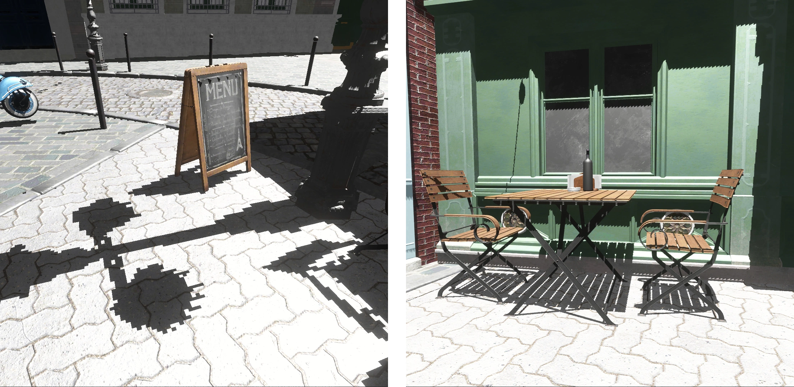
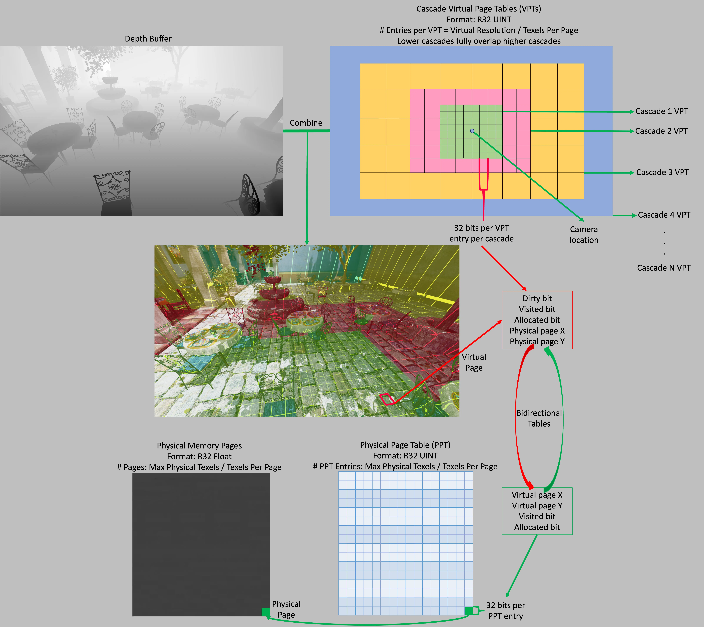
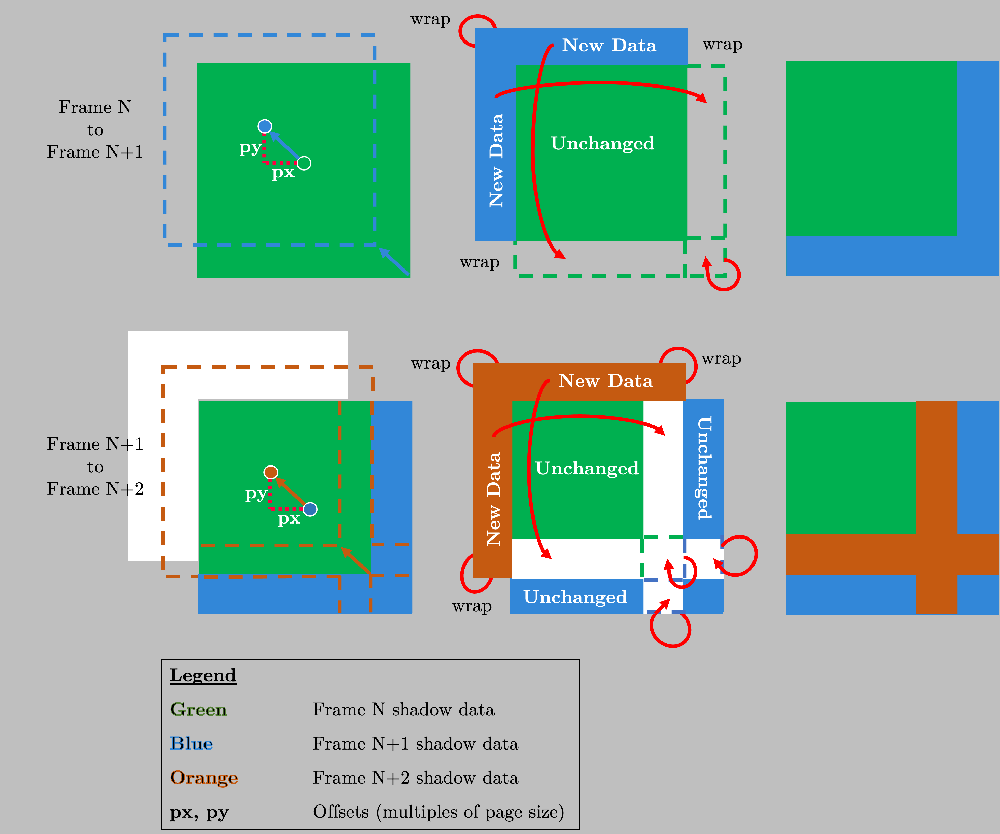
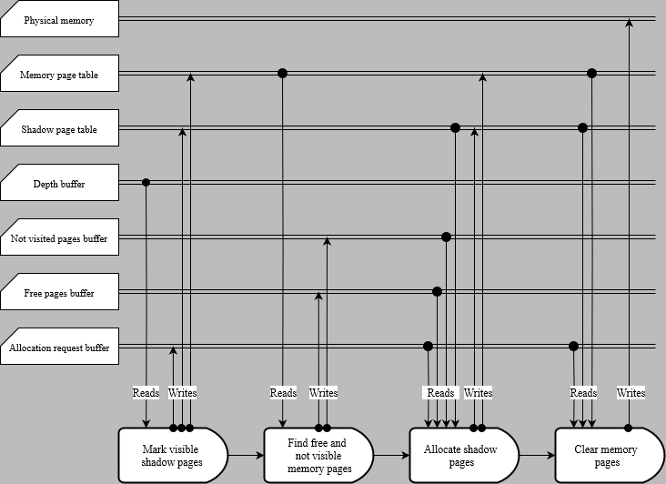
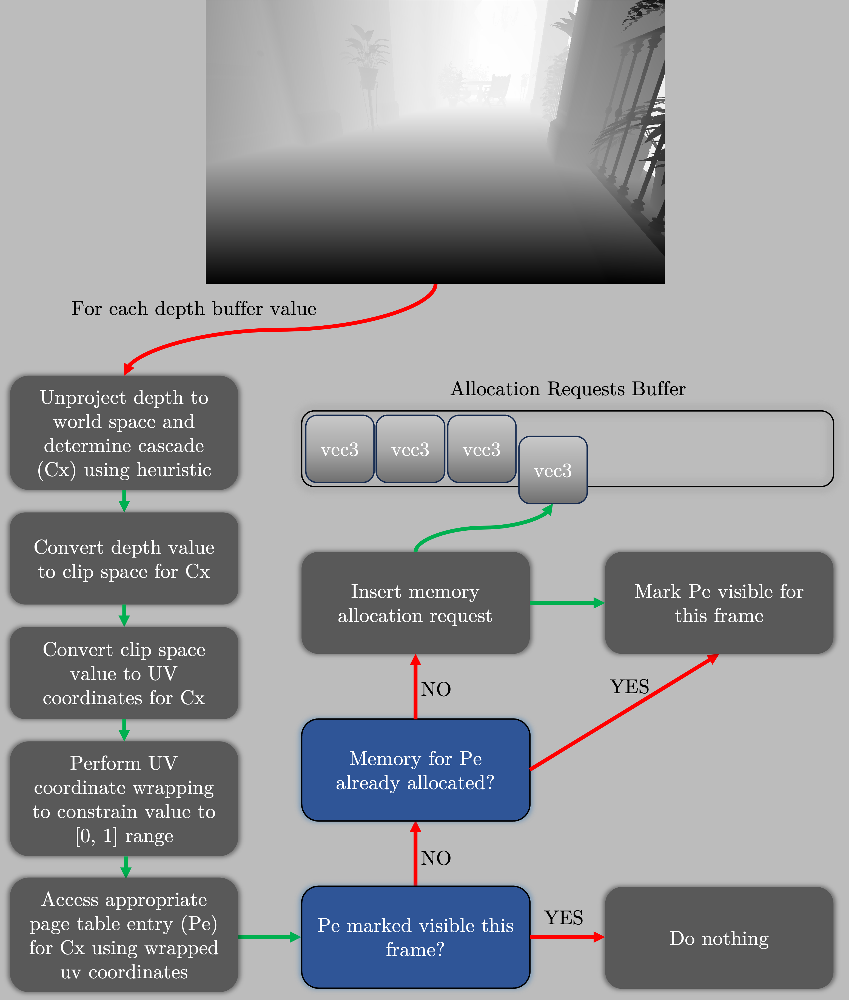
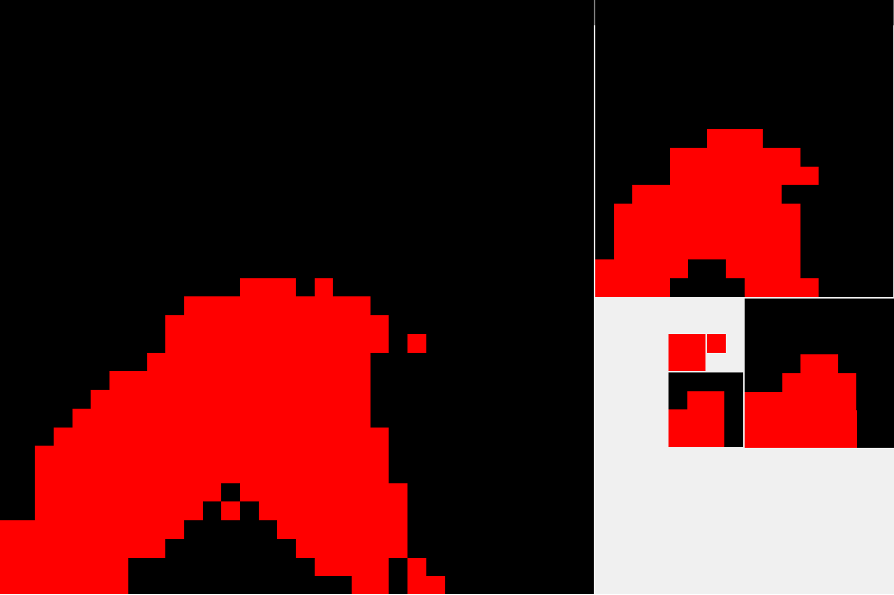
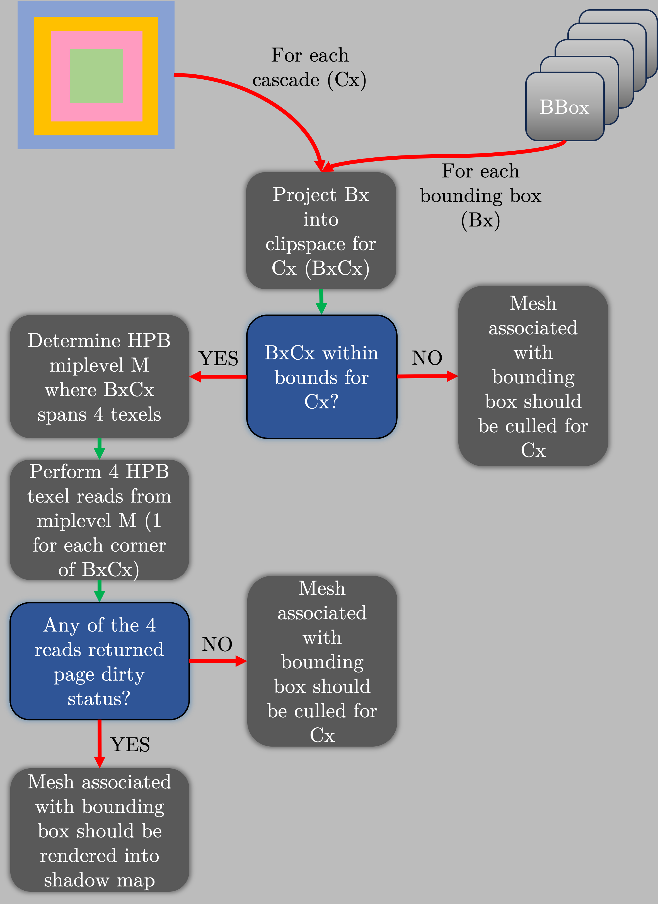
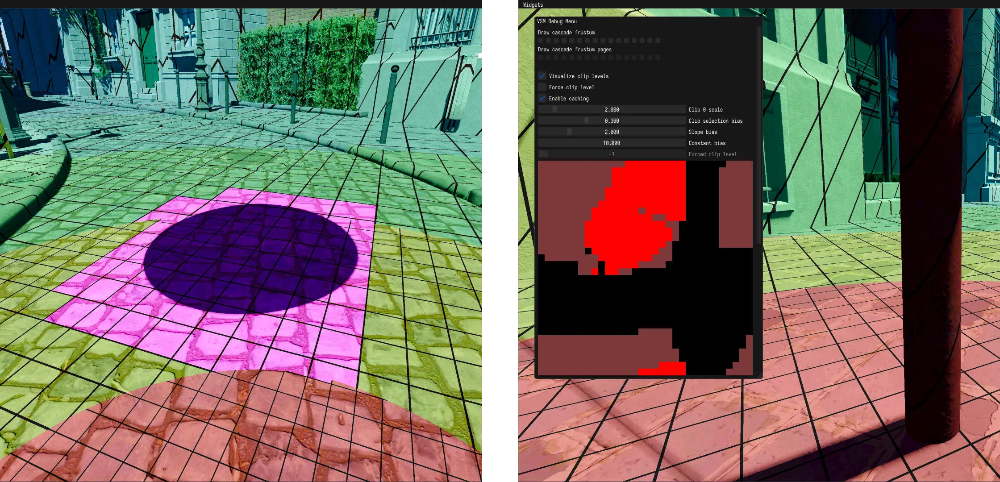
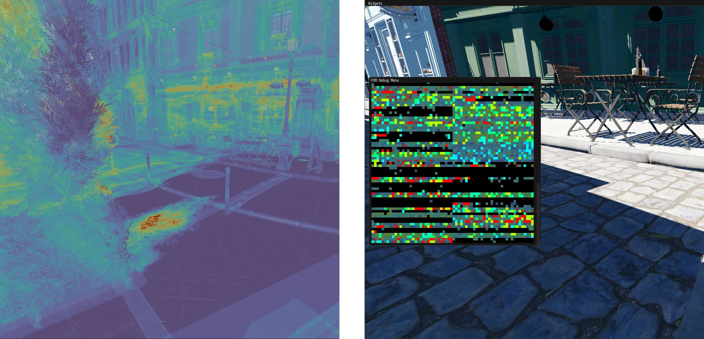

This is a copy of a near-final version of the article we published in GPU Zen 3, translated from LaTeX to Markdown.

<!-- truncate -->

## 1 Introduction

Shadow mapping is ubiquitous in real-time applications due to its good performance and compatibility with existing rasterization pipelines. However, the growing demands for graphical fidelity and performance continue to increase the complexity of shadow mapping techniques. The simplest way to increase the quality of a shadow map$-$increasing its resolution$-$scales its memory cost quadratically and increases the likelihood of cache misses when sampling, leading to worse performance. This makes it an impractical way to achieve acceptable quality in diverse scenes. Moreover, shadow maps suffer from two major forms of aliasing: perspective aliasing and projective aliasing, shown in figure 1.



> Figure 1: Left: shadows exhibiting perspective aliasing from insufficient shadow map resolution. Right: projective aliasing can be seen by the jagged shadow edges on the wall.

Perspective aliasing occurs when screen pixels do not map to shadow texels in a one-to-one manner. In a basic shadow map implementation, this can be observed by simply moving the viewer closer to or farther from the edge of a shadow. When close, the edge has a jagged appearance due to individual shadow texels mapping to many screen pixels. Even when filtered, a slight shift in occluding geometry or the casting light will appear jittery. When far from the shadow, the shadow map over samples the scene and consumes more memory than necessary.

When the direction of incident light is almost parallel to the surface, projective aliasing occurs. In this case, the projection of a texel onto that surface will cover a large area, making the depth sample an inaccurate representation of the blocker. For an observer, this gives the edges of shadows a jagged appearance, even when there is otherwise no visible perspective aliasing.

### 1.1 Previous Work

*Cascaded Shadow Maps* (CSMs) is a popular algorithm used to alleviate both types of aliasing in directional lights [Dim07]. In CSMs, the viewer's frustum is partitioned into smaller frusta, each fit with its own light space matrix and assigned a shadow map. The scene is then rendered to each shadow map using the cascade's frustum. The result is an improved distribution of shadow texels. A denser shadow map is placed near the viewer where detail is most needed, while distant regions receive coarser shadows. *Sample Distribution Shadow Maps* (SDSMs) improve CSMs by using a per-frame analysis of the scene to calculate tight-fitting frusta, maximizing the efficiency of the shadow sample distribution regardless of scene content [LSL11].

Although these techniques reduce aliasing, the fundamental compromise between shadow quality and memory cost remains. It is thus common for rendering engines to provide several options for shadows, each with their own set of trade-offs. For example, screen-space ray tracing is often used for sharper and more detailed contact shadows in contrast to those provided by shadow mapping implementations.

With the release of Unreal Engine 5 (UE5), Epic Games added *Virtual Shadow Maps* which scale to support the detailed geometry enabled by Nanite [epi22, Kar21].

### 1.2 Virtual Memory Overview

Virtual Shadow Maps (VSMs), as the name might suggest, are an application of *virtual textures* [vW09, Bar] for shadow mapping. Virtual texturing itself is essentially a generalization of *virtual memory*.

By separating the logical address space (seen by the user) from its physical backing, the appearance of a very large contiguous memory space can be achieved without the need to reserve physical memory for it. This is done by dividing the logical address space into pages that are dynamically backed by physical memory.

Virtual memory provides numerous benefits in operating systems. For virtual texturing and thus also for VSMs, its primary purpose is to provide an abstraction allowing for a highly reduced texture memory footprint. That is, only the pages of a VSM that are visible need to be allocated.

As mentioned above, it is common to combine multiple shadowing algorithms to achieve the best visual result. The efficient distribution of shadow texels that VSMs offer makes them viable as a standalone technique. Thus, VSMs also serve to unify multiple shadowing paths, making it easier to author scenes without having to consider how each path may be affected.

Inspired by UE5, we re-derive and implement Virtual Shadow Maps in our renderer. This article and the accompanying demo application serve as pedagogical tools to understand this technique. This is mainly motivated by the lack of resources that describe this technique in detail at the time of writing. [Haa15] is the only resource we could find that mentioned VSMs, and it only does so in passing.



> Figure 2: Virtual memory system overview.

## 2 Implementation

Our implementation supports a VSM for a directional light, consisting of 16 overlapping $4096\times4096$ cascades arranged in a concentric manner. Every cascade consists of a sparsely allocated set of pages, with each page spanning $128\times128$ texels. Each cascade's frustum is twice the size of the previous cascade's. The size of the first cascade, specified in world-space units, thus determines the resolution and quality of the entire VSM. In our implementation, we chose to make our first cascade $2\times2$ meters wide, with the last cascade covering a diameter of 65 km. The virtual resolution of cascades, their number, and the resolution of pages can vary.

A *virtual page table* (VPT) is used to map virtual addresses to physical addresses when we sample the shadow map. The VPT also contains metadata: page allocation status, visibility status, and a dirty flag. The allocation status flag marks pages that are backed by a physical page. The visibility status flag indicates whether the page is visible to the viewer in this frame. The dirty status flag indicates that the physical page contents are no longer valid and should be redrawn. We further define a *physical page table* (PPT) which provides the mapping of physical pages to virtual pages (the inverse of the VPT).

Sparse (or tiled) resources in graphics APIs initially seem like an obvious choice for VSMs. However, the API for sparse resources does not allow for an indirect GPU-driven approach. To know which VSM pages need to be backed by physical memory would require GPU readback. This adds unacceptable latency and leads to shadow pop-in. Our implementation opts for a manual allocation scheme that allows for execution of every part of the algorithm on the GPU and avoids this round trip latency.

### 2.0.1 Page Caching



> Figure 3: Sliding window and caching.

Caching is a common and important optimization for shadow mapping in the semi-static scenes frequently found in real-time applications. We implement a per-page caching scheme for VSMs. After a page is drawn and sampled, it is not discarded. Instead, its contents are preserved, and the allocation is left untouched, continuing its lifetime into the next frame. By doing this, we minimize the number of required draws and allow for more efficient culling.

To support caching, individual cascade frustums are snapped to the page grid. Further, the light position is constrained so that, when modified, it slides along a plane parallel to the near-plane of the respective light matrix. This constraint is necessary for the depth stored in cached pages to remain valid even after translating the light matrix.

As the cascade frustum moves to follow the main camera, new pages, previously located on the edge just outside of the cascade frustum, might need to be drawn. In order to preserve previously cached pages, we utilize a sliding window, also called *2D wraparound addressing* [AH05]. As new pages enter the frustum when it moves, old pages exit. With a sliding window, the newly entered pages are mapped to the location in the VPT previously occupied by old, exiting pages. This requires us to store a per-cascade offset of the respective light matrix position from the origin. Therefore, a translation function projecting from virtual page coordinates into wrapped coordinates is given by listing 1. The wrapped coordinates are then used to lookup VPT entries.

```glsl
ivec3 virtual_page_coords_to_wrapped_coords(ivec3 page_coords, ivec2 cascade_offset)
{
    // Make sure that the virtual page coordinates are in page table bounds to prevent erroneous wrapping
    if( any(lessThan(page_coords.xy, ivec2(0))) || 
        any(greaterThan(page_coords.xy, ivec2(VSM_PAGE_TABLE_RESOLUTION - 1))) )
    {
        return ivec3(-1, -1, page_coords.z);
    }
    const ivec2 offset_page_coords = page_coords.xy + cascade_offset.xy;
    
    const ivec2 wrapped_page_coords = ivec2(mod(offset_page_coords.xy, vec2(VSM_PAGE_TABLE_RESOLUTION)));
    // Third coordinate specifies the VSM cascade level
    return ivec3(wrapped_page_coords, page_coords.z);
}
```

> Function used to convert from coordinates obtained by projecting by cascades light matrix into wrapped coordinates.

In dynamic scenes, it is sometimes necessary to invalidate cached pages. For example, changing the direction of a directional light will invalidate all its pages. A mechanism to invalidate cached pages overlapped by moving objects is also necessary.

We will now explain in further detail each step of our approach to implementing Virtual Shadow Maps. Figure 2 gives an overview of our implementation of VSMs.

## 2.1 Bookkeeping

The bookkeeping phase comprises a set of smaller tasks that prepare the data to draw the shadow map. This consists of five steps, which will be described in detail in this section. The execution flow diagram, along with all the resources used, can be seen in Figure 4.



### 2.1.1 Freeing Invalidated Pages

The first step in bookkeeping is to free cached pages that have been invalidated by a change in the position of the light matrix or by the page intersecting a moving object. From the CPU, we receive a per-cascade input containing the number of pages the light matrix moved compared to the previous frame and a bitmask representing the set of pages invalidated by dynamic objects. We then simply free the appropriate entries in the VPT by resetting their allocation status to 0.

The code freeing invalidated pages is then given by listing 2.

```glsl
// Cascade shift gives the offset in pages relative to the cascade position previous frame
// Cascade offset is the offset used for the sliding window
void free_wrapped_pages(ivec2 cascade_shift, ivec2 cascade_offset)
{
    const ivec3 page_coords = ivec3(gl_LocalInvocationID.xyz);

    const bool should_clear_wrap = 
        (clear_offset.x > 0 && page_coords.x <  cascade_shift.x) || 
        (clear_offset.x < 0 && page_coords.x >  VSM_PAGE_TABLE_RESOLUTION + (cascade_shift.x - 1)) || 
        (clear_offset.y > 0 && page_coords.y <  cascade_shift.y) || 
        (clear_offset.y < 0 && page_coords.y >  VSM_PAGE_TABLE_RESOLUTION + (cascade_shift.y - 1));
    const bool should_clear_dynamic = extract_page_bit_from_mask(page_coords, bitmask);
    const ivec3 wrapped_page_coords = virtual_page_coords_to_wrapped_coords(page_coords, cascade_offset);

    if(should_clear_wrap || should_clear_dynamic)
    {
        const uint page_entry = imageLoad(virtual_page_table, wrapped_page_coords).r;
        if(get_is_allocated(page_entry))
        {
            imageStore(virtual_page_table, wrapped_page_coords, uvec4(0));
        } 
    }
}
```

> Listing 2: Function used to free invalidated pages. First, we determine if the virtual page needs to be freed from the data sent from CPU. If the page does need freeing, we translate into wrapped corrdinates and reset its state.

### 2.1.2 Mark Visible Pages



> Figure 5: Overview of the depth analysis used to select a suitable cascade
for each pixel.

Each screen pixel is assigned a shadow cascade index based on a heuristic. A heuristic is used because simply choosing the most detailed possible cascade does not provide adequate control over shadow detail and memory consumption.

We describe two different heuristics, each of which has its own advantages and disadvantages.

The first heuristic prioritizes achieve pixel-perfect shadows---a one-to-one mapping of screen pixels to shadow-map texels. This heuristic is similar to how mipmap levels are selected when sampling textures. To achieve this, we obtain the world space size of each texel by unprojecting its opposing sides into world space and finding their distance. The clip level is then decided by the following formula:

$\mathrm{level} = \mathrm{max}\left(\Bigl\lceil \log_2\left(\frac{T_w}{T_{c_0}}\right)\Bigr\rceil, 0\right)$

where $T_w$ and $T_{c_0}$ are the screen space texel world size and cascade 0 texel world size, respectively. Although this heuristic has a theoretically optimal cascade selection, it does not take into account the available resolution of each cascade. This may cause a pixel to fall into a cascade outside of the cascade frustum itself. This happens when the resolution of the shadow map is close to or higher than the resolution of the screen. In practice, a biasing term can be introduced, offsetting the cascade selection to favor higher cascades.

The second heuristic is simpler and does not achieve as tight of a screen pixel to shadow texel mapping as the first. In contrast to the first heuristic, the issue of mapping texels outside of each cascade frustum is not present. The formula of the second heuristic is given by the following equation:

$\mathrm{level} = \mathrm{max}\left(\Bigl\lceil \log_2\left(\frac{d}{s_{c_0}}\right)\Bigr\rceil,0\right)$

where $d$ is the world-space distance of the texel from the camera and $s_{c_0}$ is the side length of the 0th cascade's frustum. An advantage of this heuristic is that the chosen level for a given location in world space is rotationally invariant; that is, if the viewer rotates their camera, no virtual page that remains in view will be invalidated.

To know which pages need to be drawn, we first need to find the set of pages that are visible in this frame. This consists of a pass over the current frame depth buffer. Similarly to SDSM, VSM requires a full-resolution depth buffer drawn from the viewer's perspective. For each depth texel, one of the previously described heuristics is used to select the corresponding cascade. Using the selected cascade matrices, the fragment is reprojected into the cascade UV coordinates and the corresponding entry from the VPT is read. Then one of three actions is taken, depending on the state of the page stored in the page table. If the page has not yet been allocated, its coordinates are added to the buffer storing allocation requests for this frame. If the page is already allocated but not yet marked as visible, we mark it as visible this frame. Lastly, if the page is allocated *and* marked as visible, we do nothing.

### 2.1.3 Filling Allocator Buffers

In preparation for allocation, we distribute the physical pages into two buffers. The first buffer contains the coordinates of all pages that have not yet been allocated to a VSM page. The second buffer holds the coordinates of all physical pages that have been allocated but are backing virtual pages that were not marked as visible in this frame. If a physical page is both allocated and backs a shadow map page that is visible in this frame, it is not inserted into either buffer since it will not be freed.


> Figure 6: Overview of the page allocation system.

### 2.1.4 Allocating Pages

The allocation pass maps the shadow map pages stored in the allocation requests buffer to physical pages stored in the two buffers prepared in the last step. The allocator attempts to use physical pages from the first buffer, holding unallocated pages. Only when there are insufficient free pages are the pages in the second buffer used. In this case, the page must first be freed before it is reused. Since the physical page entry stores the coordinates of the virtual page that it backs, freeing the physical page and assigning it to a virtual page can both be done in the same pass. Before proceeding with the allocation, we look up the virtual page entry currently backed by the physical page and reset it to the not allocated state. To complete the allocation, both the physical page and new virtual page are marked as allocated, and each stores the others' coordinates for future reference.

### 2.1.5 Clear Pages

Before drawing the VSM, we need to clear the physical memory of the dirty pages. We cannot simply clear all physical pages, as we wish to preserve cached pages. Therefore, we use the allocation requests buffer to determine pages that have just been allocated and need to be cleared. Then, an indirect dispatch clears the corresponding physical pages.

## 2.2 Drawing Phase

### 2.2.1 Hierarchical Page Culling

After determining which virtual pages are visible to the viewer and allocating physical pages to back them, the scene is rendered to each cascade. Due to the VSM having many cascades, it is critical to have effective and granular scene culling. In a typical frame, only a fraction of the pages in each cascade will be marked as dirty at any time. With this knowledge, we define a structure called the hierarchical page buffer (HPB). Similarly to how a hierarchical Z buffer (HiZ) [GKM93] is built from the depth buffer for the purpose of occlusion culling, we build HPB from each cascade VPT for the purpose of culling geometry that does not overlap any dirty page. Thus, each HPB level is constructed as a $2\times2$ reduction of the lower level, with the lowest level reducing the VPT itself. Contrary to HiZ, we do not reduce the depth. Instead, we do a max reduction of the dirty status flag marking the page as being drawn into this frame.



> Figure 7: Mip chain for the Hierarchical Page Buffer. Red: dirty page. Black: cached or unused page.

To achieve granular culling, our drawing was implemented with meshlets combined with mesh shaders. One meshlet is mapped to a single task shader invocation. The task shader, also called the amplification shader, performs frustum culling followed by culling against the HPB.

When culling geometry against the HPB, we follow a process almost identical to culling against a HiZ. First, the meshlet bounding box is projected by the cascade light matrix. The minimum and maximum bounds of the projected bounding box are then calculated, and the appropriate level of the HPB is selected. The selection is done in the same way as when using HiZ, we select the level in which the bounding-box bounds intersect exactly four texels. Lastly, if any of the four intersected texels is marked as dirty, the meshlet survives culling; otherwise, it is discarded.

After culling, a group of 32 mesh shader threads is dispatched for each of the surviving meshlets. The fragment shader calculates the page entry coordinates, translates them into wrapped coordinates, and looks up the corresponding VPT entry. Fragments that are mapped to page entries that are not marked both allocated and dirty do nothing. Fragments that map onto a valid VPT page read the physical page coordinates from the virtual page entry. Following this, the fragment offset inside the physical page is calculated, and an atomic min operation is used to store the new depth. The fragment shader code is presented in Listing 3.

Although this culling system is used for our implementation of VSMs, it can be applied more generally to any shadow mapping algorithm. To build an HPB for culling, the only input needed is the set of visible shadow pages, which is derived from the Mark Visible Pages pass.

```glsl
layout (location = 0) in flat uint cascade_index;
layout (location = 1) in flat ivec2 cascade_offset;
void main()
{
    const vec2 virtual_uv = gl_FragCoord.xy / VSM_TEXTURE_RESOLUTION;
    const ivec3 page_coords = ivec3(floor(virtual_uv * VSM_PAGE_TABLE_RESOLUTION), cascade_index);
    const ivec3 wrapped_page_coords = virtual_page_coords_to_wrapped_coords(page_coords, cascade_offset);
    
    const uint page_entry = imageLoad(virtual_page_table, wrapped_page_coords).r;

    if(get_is_allocated(page_entry) && get_is_dirty(page_entry))
    {
        const ivec2 physical_page_coords = unpack_physical_page_coords(page_entry);
        const ivec2 virtual_texel_coords = ivec2(gl_FragCoord.xy);
        const ivec2 in_page_texel_coords = ivec2(mod(virtual_texel_coord, VSM_PAGE_SIZE));
        const ivec2 in_memory_offset = physical_page_coords * VSM_PAGE_SIZE;
        const ivec2 memory_texel_coords = in_memory_offset + in_page_texel_coord;

        imageAtomicMin(vsm_memory, memory_texel_coords, floatBitsToUint(gl_FragCoord.z));
    } 
}
```

> Listing 3: The fragment shader used to draw the shadowmaps into pages in memory. First, we check if the fragment maps to a page that should be drawn into. Following is a translation process from the unwrapped VPT coordinates into the location of the texel in the memory block assigned to the virtual page. Lastly, image atomic min is performed storing the new fragment depth.

## 2.3 Sampling Phase

When sampling the VSM, the cascade of the shaded pixel needs to be determined. For this purpose, we reuse the heuristic that was used to mark visible pages. The receiver's position is transformed into the light space of the sampled cascade. This is then translated into the VPT texture coordinates and wrapped to obtain the final VPT entry location. From the VPT entry, the coordinates of the physical texel in the physical page are calculated following the same process utilized when drawing VSM pages.

Although the VSM is detailed, a single shadow sample per shaded texel is insufficient for compelling soft shadows. For this purpose, further filtering of the VSM needs to be used. Common shadow filtering algorithms, such as PCF and PCSS [Fer05] can be used together with VSMs. The same steps as described above are applied to a number of samples in a region around the shaded pixel.

Although this approach works for most shaded pixels, an issue arises when the sampling region crosses the physical page boundary. The pass marking the visible pages assumes that we will perform a shadow test only for the texels visible in this frame. When filtering, this assumption is broken. One or more samples from the filtering region may fall into parts of the world that are not visible from the main camera. The guarantee of at least one physical page backing each sampled texel thus no longer holds.

This can cause artifacts when the edge of a shadow is near the edge of a page. To mitigate the issue and restore the guarantee when shadow filtering is desired, the *Mark Visible Pages* pass must be modified. Instead of marking only the page directly corresponding to the visible texel, we mark all pages lying in a region around it. This region must be greater than or equal to the size of the filtering region.



> Figure 8: HPB culling scheme overview.

## 3 Results


> Figure 9: Hard shadows from three perspectives in a scene containing 5km-wide terrain and Bistro. The VSM parameters remained the same for each image. A single $4096\times4096$ texture provided sufficient physical memory in each case.

All performance data was collected with an RTX 3070 GPU and R9 5950X CPU. Performance was tested by moving the camera along a predetermined path in the Bistro scene containing $\approx4,000,000$ triangles.

Figure 9 shows a scene containing millimeter-scale and kilometer-scale geometry, which poses a significant problem for traditional solutions. VSMs overcome the issues by allocating memory to near and distant pages as necessary.

We show how VSMs allow us to achieve nearly pixel-perfect shadows in diverse scenes for the price of just one $4096\times4096$ backing texture. For example, if a density of one shadow texel per screen texel is desired, the upper bound of memory usage will be approximately equal to the number of screen pixels in well-behaved scenes.

Additional cascades that are not visible incur the trivial cost of maintaining bookkeeping structures (the VPT and PPT). Only if any page in a cascade becomes dirty does the scene need to be culled and rendered to it.

$$
\begin{array}{|c|c|c|c|c|}
    \hline
      & \text{Bookkeeping} & \text{Cull and draw} & \text{Total}\\
    \hline
    \text{Uncached, 4096, 128} & 245 \mu s & 2128 \mu s & 2373 \mu s\\
    \hline
    \text{Cached, 4096, 128} & 103 \mu s & 285 \mu s & 388 \mu s\\
    \hline
    \text{Uncached, 4096, 64} & 216 \mu s & 1858 \mu s & 2074 \mu s\\
    \hline
    \text{Cached, 4096, 64} & 109 \mu s & 350 \mu s & 459 \mu s\\
    \hline
    \text{Uncached, 2048, 128} & 150 \mu s & 985 \mu s & 1135 \mu s\\
    \hline
    \text{Cached, 2048, 128} & 99 \mu s & 238 \mu s & 337 \mu s\\
    \hline
    \text{Uncached, 2048, 64} & 137 \mu s & 811 \mu s & 948 \mu s\\
    \hline
    \text{Cached, 2048, 64} & 103 \mu s & 217 \mu s & 320 \mu s\\
    \hline
\end{array}
$$

> Table 1: Mean GPU times for the primary passes in various configurations. Cached: the previously-described scheme for caching pages is used. Uncached: every visible page is redrawn every frame. 2048 and 4096 refer to the square root of the number of texels in the VSM. 64 and 128 refer to the square root of the size of a page in the VSM.

$$
\begin{array}{|c|c|}
    \hline
    \textbf{Samples} & \textbf{Time}\\
    \hline
    0 (base) & 314\mu s\\
    \hline
    1 & 375\mu s\\
    \hline
    4 & 509\mu s\\
    \hline
    8 & 635\mu s\\
    \hline
    16 & 886\mu s\\
    \hline
\end{array}
$$

> Table 2: Mean GPU times for our shading pass at $1920\times1080$ with various VSM sample counts. We found no correlation between the VSM or page size and the shading time. The test was done using a $4096\times4096$ VSM with $128\times128$ pages.

## 4 Future Work

### 4.1 Translucency and participating media

Some shadow-receiving effects do not contribute to the depth buffer, subverting our depth-based analysis in *Mark visible pages*. Translucent objects and ray-marched participating media are common examples of such effects. Because they do not have correlation with the depth buffer, the VSM may lack depth information where they sample, producing errors in the resulting shadows.

One way to solve this issue is to ensure that every location in the viewer frustum has at least one valid page that could be sampled. To minimize memory usage, pages from coarser cascades that intersect the frustum should be marked visible. This ensures that low-resolution shadows are available everywhere. This strategy is used by UE5.

A different strategy is to mark the page as visible when a page fault occurs. With this, the page will become backed by physical memory the next time the allocator is executed. Although simpler, this approach leads to shadows "popping in" as there is a one frame latency between the page fault and the allocation. To mitigate this, the non-depth-writing passes can be executed one more time each frame, recording page faults before the allocation pass.

### 4.2 Local lights

While UE5 has proven that using VSMs for local lights is feasible, we elected to simplify our implementation by focusing on directional lights only.

### 4.3 Dynamic time of day

As previously described, a change in the light source's position or direction requires all pages in its VSM to be invalidated. With a dynamic time-of-day system, all pages would be invalidated every frame.

To maintain cached pages, the Sun's rotation can be quantized such that invalidation only occurs every N frames. A reprojection scheme like the one described in [Pav19] can be used to eliminate the resulting artifacts.

### 4.4 Optimizations

Optimizing the drawing phase of VSMs remains an open problem for us. Profiling and empirical testing revealed reducing fragment shader invocations (particularly those that do not map to dirty pages) to yield the largest performance gains. Our current optimizations (HPB culling and caching) focus on this.

The most granular way to avoid fragment shader invocations on non-dirty pages is to use compute shader rasterization. With this, fixed-function costs and helper invocations on the edges of triangles would be avoided. We suspect a substantial benefit for coarser VSM cascades, due to the triangles becoming proportionately smaller.



> Figure 10: Left: visualization showing the cascade levels and visible pages. The pink pages are those invalidated by the motion of a moving sphere whose shadow is visible. Right: the status of each page in first VSM cascade is shown. Currently visible pages are denoted by bright red. Pages that are cached, but not visible are denoted by dark red. Black pages consume no physical memory.



> Figure 11: Left: Because our shadow rendering is bound by fragment shader invocations, having a visualization of shadow overdraw was important. Right: a texture showing the status of pages in the PPT. Hotter colors correspond with lower (near) cascades, with red being the nearest. Darker colors denote cached pages, as in Figure 10.

## 5 Acknowledgements

Matej Sakmary was supported by the Grant Agency of the Czech Technical University in Prague, project no. SGS22/173/OHK3/3T/13. Thanks to the\_Demongod for his contributions in reviewing and editing this article.

## References

[AH05] &nbsp;&nbsp;&nbsp;&nbsp; Arul Asirvatham and Hugues Hoppe. Terrain rendering using gpu-based geometry clipmaps. *GPU gems*, 2(2):27–46, 2005.

[Bar] &nbsp;&nbsp;&nbsp;&nbsp; Sean Barrett. Sparse virtual texture memory.

[Dim07] &nbsp;&nbsp;&nbsp;&nbsp; Rouslan Dimitrov. Cascaded shadow maps. *Developer Documentation, NVIDIA Corp*, 2007.

[epi22] &nbsp;&nbsp;&nbsp;&nbsp; Virtual shadow maps, 2022.

[Fer05] &nbsp;&nbsp;&nbsp;&nbsp; Randima Fernando. Percentage-closer soft shadows. In *ACM SIGGRAPH 2005 Sketches*, pages 35–es. 2005.

[GKM93] &nbsp;&nbsp;&nbsp;&nbsp; Ned Greene, Michael Kass, and Gavin Miller. Hierarchical z-buffer visibility. In *Proceedings of the 20th annual conference on Computer graphics and interactive techniques*, pages 231–238, 1993.

[Haa15] &nbsp;&nbsp;&nbsp;&nbsp; Ulrich Haar. Gpu-driven rendering pipelines. Conference Presentation, 2015.

[Kar21] &nbsp;&nbsp;&nbsp;&nbsp; Brian Karis. Nanite: A deep dive. Conference Presentation, 2021.

[LSL11] &nbsp;&nbsp;&nbsp;&nbsp; Andrew Lauritzen, Marco Salvi, and Aaron Lefohn. Sample distribution shadow maps. In *Symposium on Interactive 3D Graphics and Games*, pages 97–102, 2011.

[Pav19] &nbsp;&nbsp;&nbsp;&nbsp; Turchyn Pavlo. Parallax-corrected cached shadow maps. In GPU Zen 2, pages 143–152. 2019.

[vW09] &nbsp;&nbsp;&nbsp;&nbsp; J.M.P. van Waveren. id tech 5 challenges. Conference Presentation, 2009.
